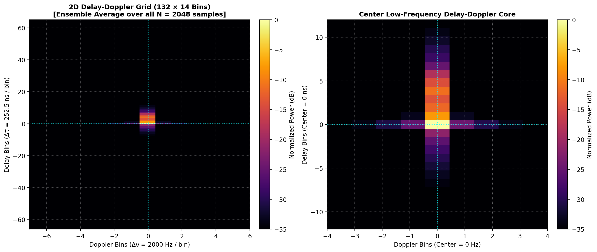
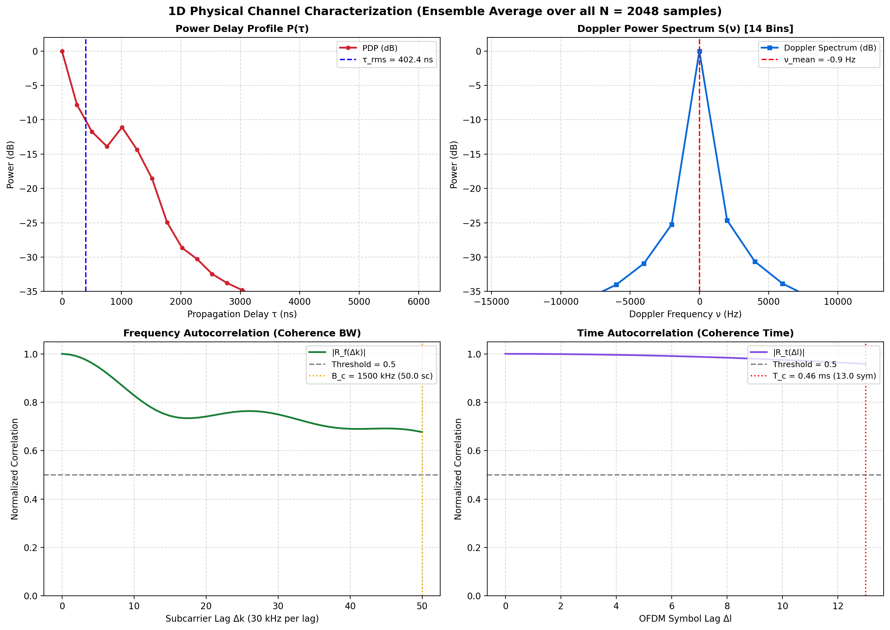
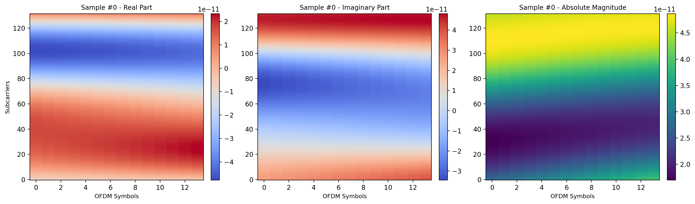

# Channel Dataset Physical Characterization Report

- **Target Folder:** `DUR300nsFix_NLoS_port1_Apos2_2p18G_600km_30deg_r15km_20to30mps/-10dB`
- **Absolute Path:** `C:\Users\AT30890\Hoctap\1_Hprediction\working\H_predict_NTN\Hest_NTN_UDA_clean\generatedChan\OpenNTN\DUR300nsFix_NLoS_port1_Apos2_2p18G_600km_30deg_r15km_20to30mps\-10dB`
- **Total Realizations:** `2048`
- **Grid Size:** `132 Subcarriers × 14 Symbols` (SCS = `30.0 kHz`)
- **Delay-Doppler Resolution:** `Δτ = 252.53 ns/bin`, `Δν = 2000.0 Hz/bin`

## 1. Physical Propagation & Coherence Metrics

| Physical Parameter | Value | Standard Interpretation |
| :--- | :---: | :--- |
| **RMS Delay Spread ($\tau_{\text{rms}}$)** | `402.40 ns` | Multipath dispersion along subcarriers |
| **Mean Excess Delay ($\bar{\tau}$)** | `193.77 ns` | Center of multipath power distribution |
| **Coherence Bandwidth ($B_{c, 0.5}$)** | `1500.0 kHz` (`50.00` sc) | Frequency lag where correlation drops to 0.5 |
| **Mean Doppler Shift ($\bar{\nu}$)** | `-0.87 Hz` | Bulk orbital/velocity Doppler frequency |
| **RMS Doppler Spread ($\nu_{\text{rms}}$)** | `478.80 Hz` | Temporal fading velocity across OFDM symbols |
| **Coherence Time ($T_{c, 0.5}$)** | `0.46 ms` (`13.00` sym) | Time lag where correlation drops to 0.5 |
| **Channel Power (RMS)** | `5.5849e-10` | Average energy magnitude |
| **Dynamic Range** | `142.54 dB` | Peak-to-minimum power variation |

## 2. Baseline Pilot Estimation Performance

| Baseline Estimator | NMSE (dB) | SSIM |
| :--- | :---: | :---: |
| **2D Linear Interpolation ($H_{\text{li}}$)** | `10.66 dB` | `1.0000` |

## 3. Visual Characterization Plots

### 2D Delay-Doppler Energy Distribution (Ensemble Average over all N = 2048 samples)

### 1D Physical Curves (Ensemble Average over all N = 2048 samples)

### Single Realization Snapshot (Sample #0 in Time-Frequency Domain)

