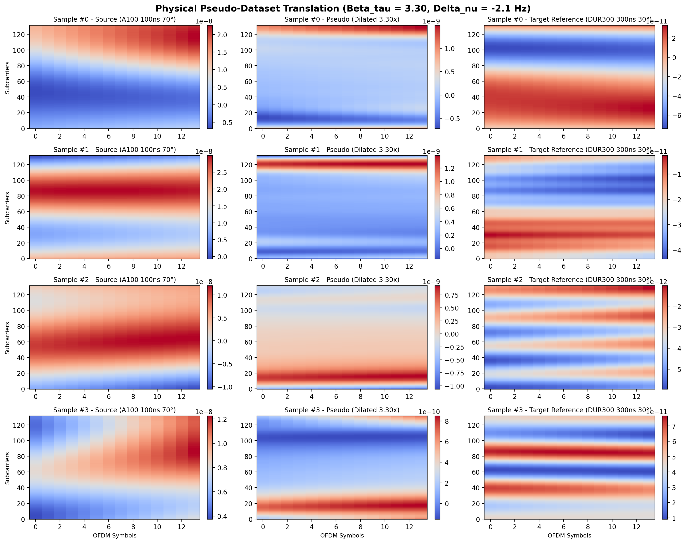

# Physical Pseudo-Dataset Generation Report

## General Information

- **Method:** Approach A (Analytical Delay Dilation & Doppler Modulation)
- **Source Dataset Directory:** `C:\Users\AT30890\Hoctap\1_Hprediction\working\H_predict_NTN\Hest_NTN_UDA_clean\generatedChan\MATLAB\A100_2p18e9_600km_70deg_30kHz`
- **Target Dataset Directory:** `C:\Users\AT30890\Hoctap\1_Hprediction\working\H_predict_NTN\Hest_NTN_UDA_clean\generatedChan\OpenNTN\DUR300nsFix_NLoS_port1_Apos2_2p18G_600km_30deg_r15km_20to30mps`
- **Output Dataset Directory:** `C:\Users\AT30890\Hoctap\1_Hprediction\working\H_predict_NTN\Hest_NTN_UDA_clean\generatedChan_mathPseudo\A100_DUR300_LS`
- **Estimated Beta_tau:** `3.2984`
- **Estimated Delta_nu:** `-2.13 Hz`
- **Scaling Mode:** `rms`

## Linked Reference Notes

- [Source Dataset Note](note_source.md)
- [Target Dataset Note](note_target.md)

## Metric Summary

| SNR (dB) | Samples | 2D Linear Interp NMSE (dB) | SSIM |
| :---: | :---: | :---: | :---: |
| -10 | 1024 | 8.62 | 0.1370 |
| -5 | 1024 | 3.66 | 0.3079 |
| 0 | 1024 | -1.29 | 0.5407 |
| 5 | 1024 | -6.10 | 0.7529 |
| 10 | 1024 | -10.44 | 0.8764 |
| 15 | 1024 | -13.90 | 0.9411 |

