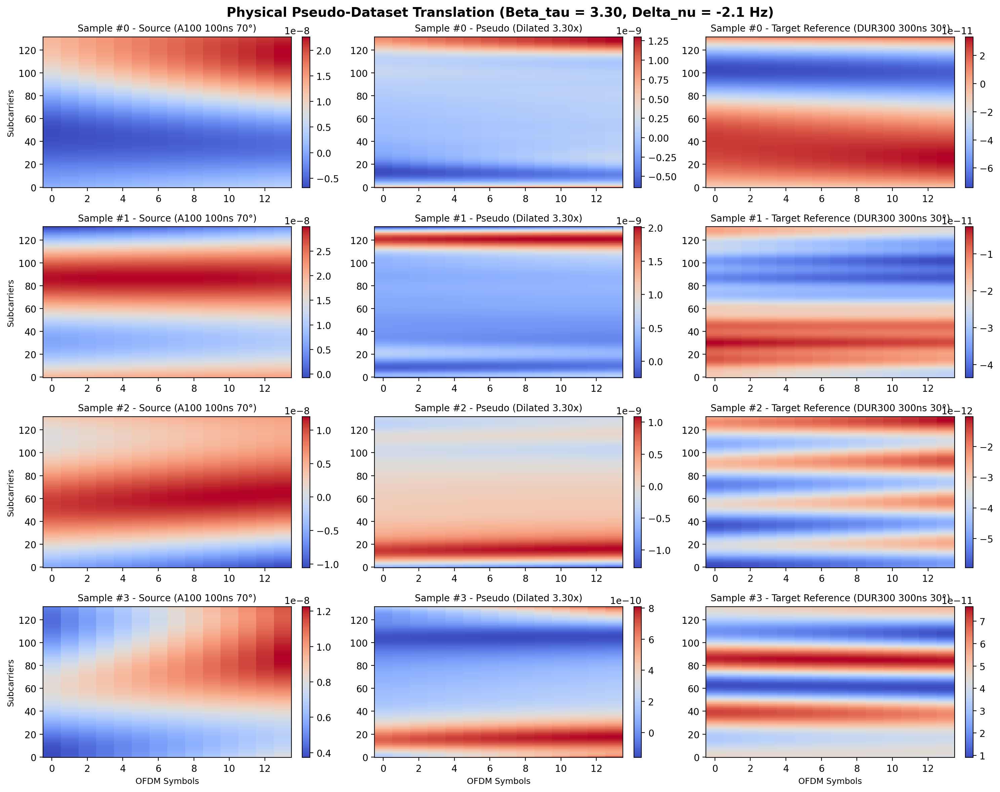

# Physical Pseudo-Dataset Generation Report

## General Information

- **Method:** Approach A (Analytical Delay Dilation & Doppler Modulation)
- **Source Dataset Directory:** `C:\Users\AT30890\Hoctap\1_Hprediction\working\H_predict_NTN\Hest_NTN_UDA_clean\generatedChan\MATLAB\A100_2p18e9_600km_70deg_30kHz`
- **Target Dataset Directory:** `C:\Users\AT30890\Hoctap\1_Hprediction\working\H_predict_NTN\Hest_NTN_UDA_clean\generatedChan\OpenNTN\DUR300nsFix_NLoS_port1_Apos2_2p18G_600km_30deg_r15km_20to30mps`
- **Output Dataset Directory:** `C:\Users\AT30890\Hoctap\1_Hprediction\working\H_predict_NTN\Hest_NTN_UDA_clean\generatedChan_mathPseudo\A100_DUR300_LS_std`
- **Estimated Beta_tau:** `3.2984`
- **Estimated Delta_nu:** `-2.13 Hz`
- **Scaling / Preprocessing Mode:** `standardize`
  - *Mechanism:* Standardized to zero-mean unit-variance, then rescaled to Target mean and std.

## Linked Reference Notes

- [Source Dataset Note](note_source.md)
- [Target Dataset Note](note_target.md)

## Metric Summary

| SNR (dB) | Samples | 2D Linear Interp NMSE (dB) | SSIM |
| :---: | :---: | :---: | :---: |
| -10 | 1024 | 11.14 | 0.1306 |
| -5 | 1024 | 6.08 | 0.2934 |
| 0 | 1024 | 1.19 | 0.5233 |
| 5 | 1024 | -3.68 | 0.7324 |
| 10 | 1024 | -8.19 | 0.8680 |
| 15 | 1024 | -12.13 | 0.9388 |

