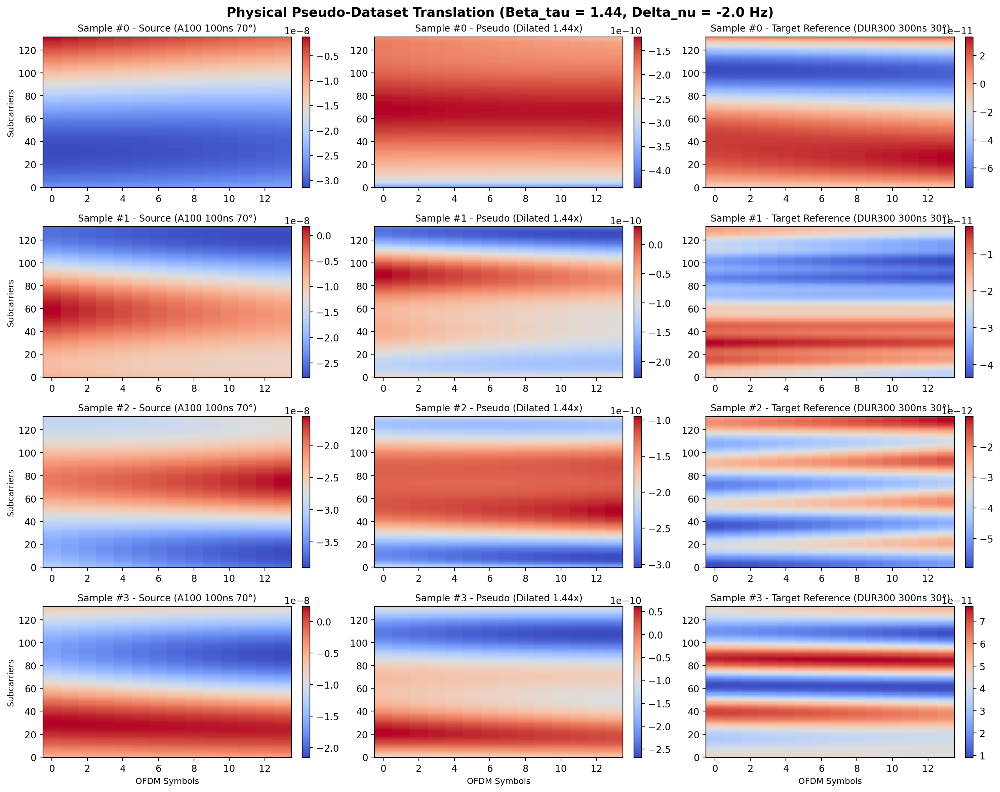

# Physical Pseudo-Dataset Generation Report

- **Method:** Approach A (Analytical Delay Dilation & Doppler Modulation)
- **Estimated Beta_tau:** `1.4372`
- **Estimated Delta_nu:** `-1.98 Hz`
- **Scaling Mode:** `rms`

| SNR (dB) | Samples | 2D Linear Interp NMSE (dB) | SSIM |
| :---: | :---: | :---: | :---: |
| 10 | 50 | -11.08 | 0.9683 |

