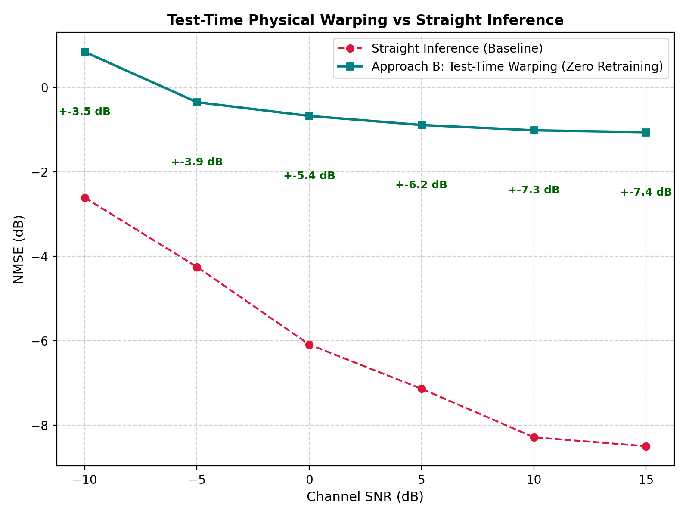

# Approach B: Test-Time Domain Adaptation Benchmark

- **Model:** `LS_Attention_rms`
- **Target Dataset:** `DUR300nsFix_NLoS_port1_Apos2_2p18G_600km_30deg_r15km_20to30mps`
- **Beta_tau:** `3.298` | **Delta_nu:** `-2.13 Hz`
- **Pilot Anchoring:** `100%`

| SNR (dB) | Straight Infer NMSE (dB) | Approach B NMSE (dB) | Gain (dB) | Straight SSIM | Approach B SSIM |
| :---: | :---: | :---: | :---: | :---: | :---: |
| -10 | -2.61 | 0.85 | **+-3.45** | 0.9809 | 0.9560 |
| -5 | -4.25 | -0.35 | **+-3.90** | 0.9747 | 0.9407 |
| 0 | -6.09 | -0.67 | **+-5.42** | 0.9753 | 0.9313 |
| 5 | -7.14 | -0.89 | **+-6.25** | 0.9823 | 0.9535 |
| 10 | -8.28 | -1.01 | **+-7.27** | 0.9856 | 0.9254 |
| 15 | -8.50 | -1.06 | **+-7.44** | 0.9818 | 0.9365 |

